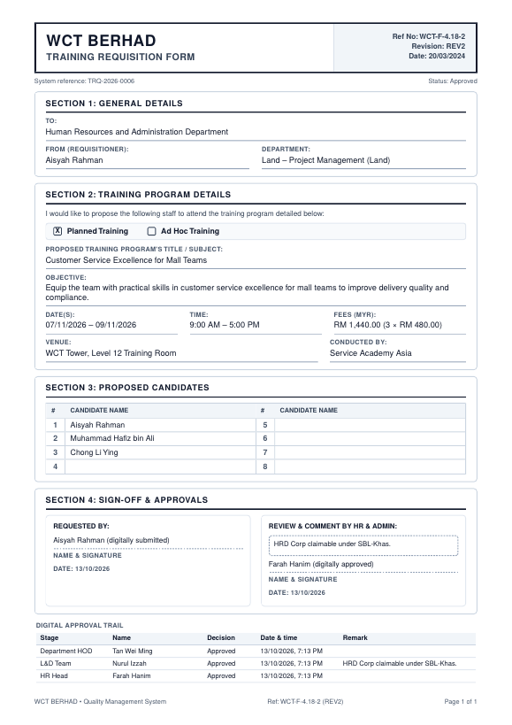

# WCT Training RQ

Digital **Training Requisition Form (WCT-F-4.18-2 REV2)** for WCT Berhad, served at
**https://hrforms.wct.my/WCT-Training-RQ/**.

Staff raise training requests, and approvals flow **Requester → Department HOD → L&D Team → HR Head**. Every decision is made inside the app, Power Automate sends the email/Teams notifications, and HR keeps a searchable history with Excel export and a printable PDF that mirrors the paper form.



## Features

- **Microsoft 365 sign-in.** Entra ID single sign-on (SSO), restricted to the WCT tenant.
- **Approval workflow.**
  - Rejections require a remark.
  - L&D can send a request back to the Requester or the HOD.
  - HR Head can send it back to the Requester, the HOD or L&D.
  - The rejector picks who is notified, and the **Business Unit Admin (Land / E&C / Malls) is always informed**.
- **Status tracking.**
  - A transit-style progress tracker on every request.
  - A full audit timeline: who did what, when, the remark, and who was notified.
  - A dashboard "availability board" showing every request of the year as colour-coded units.
- **Training RQ history.**
  - Search by ref no., title, requester, provider or **candidate name**, so you can see one employee's training history.
  - Filters and pagination.
  - **Export to Excel**.
- **Print to PDF.** Reproduces WCT-F-4.18-2 with the digital approval trail. Requests that aren't fully approved carry a "NOT FINAL" watermark.
- **Drafts, clone, amend & resubmit,** with version history and changed fields highlighted.
- **Candidate picker** that searches the M365 directory (up to 8 candidates), with manual entry as a fallback.
- **Attachments** (brochures or quotations): type, size and content checks.
- **HRD Corp claimable / grant no.,** recorded by L&D.
- **Comments** on each request, with notifications.
- **Reports.** Monthly volume and spend, by business unit and department, planned vs ad hoc, and time spent at each approval stage, with Excel export.
- **Admin settings.**
  - Business units and BU Admins.
  - Departments and HODs.
  - L&D, HR Head and System Admin roles.
  - Users.
  - Notification log with retry.
  - Audit log.
- **Usability.** Light and dark mode, mobile-friendly (approvers can act from a phone), WCAG AA colours, keyboard accessible.

## Architecture

```
Browser ─HTTPS─> Nginx (hrforms.wct.my) ── /WCT-Training-RQ ──> Next.js 16 (PM2, 127.0.0.1:3010)
                                                                  ├─ PostgreSQL 16 (Drizzle ORM)
                                                                  ├─ /var/lib/wct-training-rq/uploads
                                                                  ├─ Microsoft Entra ID (OIDC + Graph)
                                                                  └─ Power Automate HTTP flow (notifications)
```

- **Business rules** live in `src/lib/workflow`, a pure state machine with 60+ unit tests.
- **Data access and transactions** live in `src/lib/services`, tested against a real PostgreSQL.
- **UI** is the Next.js App Router in `src/app` with components in `src/components`.

The design spec and implementation plan are in `docs/superpowers/`.

## Local development

```bash
# PostgreSQL 16 running locally, then:
cp .env.example .env            # set DATABASE_URL, SESSION_SECRET, AUTH_DEV_LOGIN=true
npm ci
npm run db:migrate
SEED_DEMO=true npm run db:seed  # business units + demo departments/users (@demo.wct.my)
npm run db:seed-demo            # optional: ~30 demo requests in every status
npm run dev                     # http://localhost:3010/WCT-Training-RQ
```

With `AUTH_DEV_LOGIN=true` (development only, ignored in production), the sign-in page lists demo accounts. Set
`POWER_AUTOMATE_FLOW_URL=http://localhost:3010/WCT-Training-RQ/api/dev/flow-sink` to capture notifications locally (`GET` the same URL to inspect them).

| Script | Purpose |
|---|---|
| `npm test` | Unit tests (workflow, validation, PDF, …) |
| `npm run test:integration` | Service tests against PostgreSQL (uses `.env.test`) |
| `npm run test:e2e` | Playwright end-to-end approval flow |
| `npm run lint` / `npm run typecheck` | Static checks |
| `npm run db:generate` | Create a migration after editing `src/db/schema.ts` |

## Deployment

Pushing to `main` runs CI (lint, types, unit, integration, build, E2E). When CI passes, GitHub Actions SSHes into the Ubuntu server and runs `scripts/deploy.sh`. That script migrates, builds into a side directory, swaps the build in, reloads PM2, health-checks, and rolls back automatically if the health check fails.

- Server setup from scratch: **[docs/DEPLOYMENT.md](docs/DEPLOYMENT.md)**
- Microsoft Entra app registration: **[docs/ENTRA_SETUP.md](docs/ENTRA_SETUP.md)**
- Power Automate notification flow: **[docs/POWER_AUTOMATE.md](docs/POWER_AUTOMATE.md)**
- User guide (per role): **[docs/USER_GUIDE.md](docs/USER_GUIDE.md)**

> 🔒 This repository is **public**. Never commit `.env`, secrets, flow URLs or real data. All configuration is read from the server's `.env` (see `.env.example`).

## Brand assets

The logo is a placeholder `WCT` wordmark (`src/components/shell/wordmark.tsx`), and the accent colour is the `--brand-*` tokens in `src/app/globals.css`. Swap in the official WCT logo and corporate colours there.
